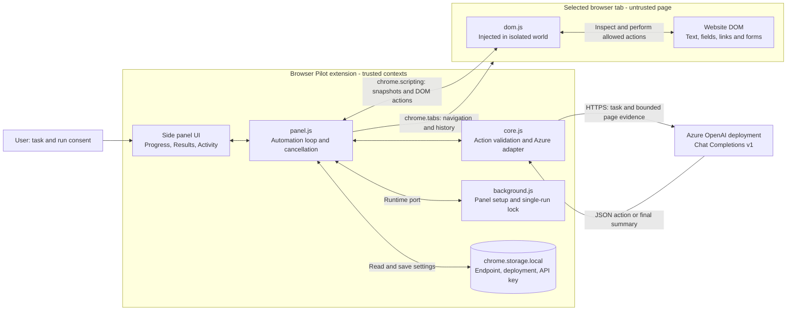
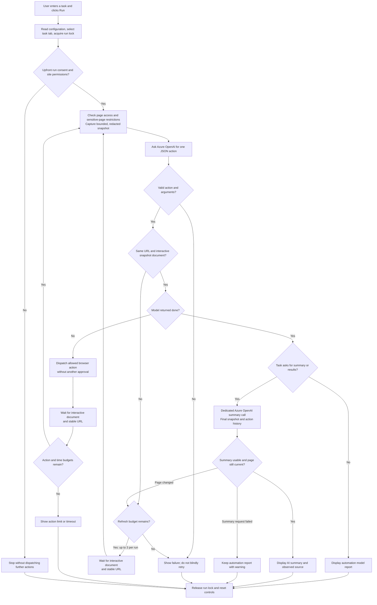

# Browser Pilot — Browser Automation

A Manifest V3 Chrome extension that translates natural-language tasks into automatic browser actions after one upfront consent. It runs locally in a side panel and connects directly to **your existing Azure OpenAI deployment**. No backend, Azure provisioning, or runtime npm dependencies are required.

## Architecture



### Component responsibilities

| Component | Responsibility |
| --- | --- |
| [manifest.json](./manifest.json) | Manifest V3 configuration, side-panel entry point, extension permissions and optional HTTP(S) host access. |
| [panel.html](./src/panel.html) / [panel.css](./src/panel.css) | Configuration, task input, upfront consent, readable progress, results and collapsible activity log. |
| [panel.js](./src/panel.js) | Owns the run: task-tab selection, permissions, model calls, execution, readiness checks, bounded redirect recovery, limits and Stop. |
| [core.js](./src/core.js) | Validates configuration and model actions, formats progress, and makes separate next-action and summary requests. |
| [dom.js](./src/dom.js) | Self-contained function injected into the main frame's isolated world; produces redacted snapshots, keeps local element references, checks targets and performs DOM actions. |
| [background.js](./src/background.js) | Opens the side panel from the toolbar, restricts storage access and coordinates one active run through a runtime port. It does **not** host the automation loop. |
| Azure OpenAI | Interprets the user's task, proposes one JSON action at a time, and optionally writes a final evidence-based summary. It does not directly control the browser. |

**Data boundaries:** the API key stays in trusted extension contexts and is sent only to the configured Azure endpoint. It is not injected into websites. Website content and model output are untrusted. The extension validates actions locally, keeps full navigation URLs and form values out of page snapshots, and sends only bounded page evidence to the model. User-entered task details still go to Azure. Runs, results, snapshots and logs are held in memory; only configuration is persisted. There is no application backend, database, or deployed Azure agent.

## Execution flow



Stop or the wall-clock timeout can interrupt the run at any stage. Pending model requests are cancelled where possible; completed browser actions cannot be undone. Permission, sensitive-page, target-validation or execution errors terminate the run rather than retrying a possibly state-changing action. Readiness waits have their own timeout. A successful action dispatch is not proof of submission success: the next snapshot supplies the evidence. Summaries remain model-generated and require user verification.

## Technology used

| Layer | Technology | Purpose |
| --- | --- | --- |
| Browser extension | Chromium Manifest V3 | Local extension packaging and permission model; Chrome 116+ is declared in the manifest. |
| Interface | HTML5, CSS, vanilla JavaScript ES modules | Side-panel UI without a frontend framework or bundler. |
| Browser integration | `chrome.sidePanel`, `chrome.tabs`, `chrome.scripting`, `chrome.permissions`, `chrome.runtime` | Panel access, navigation, isolated-world execution, site permissions and run coordination. |
| Settings | `chrome.storage.local` | Local, non-synced Azure configuration; not a secure secret vault. |
| Automation | Native DOM APIs and synthetic events | Element inspection, filling, selection, clicking, scrolling and native form submission with `requestSubmit`. |
| LLM integration | Azure OpenAI Chat Completions v1 over HTTPS `fetch` | JSON-mode action generation and a separate optional final-summary request. No runtime Azure SDK dependency. |
| Cancellation | `AbortController` / `AbortSignal` | Stop handling, model-request timeouts and run cancellation. |
| Unit testing | Node.js built-in test runner and assertions | Configuration, action validation, prompt contracts, summaries and progress formatting. |
| Browser testing | Playwright with Chromium | Disposable extension/profile tests against local fixtures and mocked Azure responses. Playwright is test-only. |
| Documentation | Markdown and Mermaid | Architecture and process diagrams; use a Mermaid-capable Markdown viewer to render them. |

## Limitations at a glance

| Area | Current boundary |
| --- | --- |
| Browser scope | One active task tab and one run at a time. Keep the side panel open. Recent desktop Edge should be compatible, but direct Edge validation has not been performed. |
| Run budgets | 20 actions, 2-minute total run, 30 seconds per model request, 15 seconds for navigation readiness, and up to 3 stale-decision refreshes. |
| Website coverage | No iframe/shadow-root traversal, CAPTCHA bypass, file-transfer tools, protected browser pages or trusted native input simulation. Some controls reject synthetic events. |
| Forms | Native GET/POST and browser form semantics, not arbitrary HTTP request generation. Cross-origin form actions, new-tab form targets and identified sensitive fields remain blocked. |
| Page availability | Interactive does not mean all asynchronous content is loaded. Paywalls, publisher access-denied pages, login requirements, overlays and anti-bot systems may prevent reading or acting. |
| Model context | Up to 6,000 characters of visible text and 120 element descriptors per snapshot. Final summaries use the final snapshot and action summaries, not the full browsing history or every article on a site. |
| Summary triggering | Dedicated summaries are triggered by supported English phrases such as `summarize` and `show results`; arbitrary wording or other languages may not trigger the extra call. |
| Accuracy | Models can choose the wrong action or give an incomplete answer. Local validation and redaction reduce risks but do not guarantee correctness, privacy or resistance to prompt injection. |
| Privacy and autonomy | One consent authorizes automatic actions and page sharing across sites for the run. No per-action review. Local API-key storage is not a vault; use only trusted, non-confidential tasks. |
| Azure compatibility | Requires an accessible supported Azure endpoint and a chat-completions deployment supporting JSON mode. No Responses-only models, Entra login, custom proxies or sovereign-cloud endpoints in this MVP. |
| Recovery | Stop cannot undo submissions or clicks. Runs do not resume after closing the panel. Some page-change races still stop safely rather than replaying actions. |

See **Privacy and limitations** below for detailed safeguards and behavior.

## Install in Chrome

1. Open `chrome://extensions` in Chrome 116 or newer.
2. Enable **Developer mode**, choose **Load unpacked**, and select this project's root folder (the folder containing `manifest.json`).
3. Pin **Browser Pilot — Browser Automation** using Chrome's Extensions menu.
4. Open an ordinary website, then click the extension icon to open its side panel.
5. Expand **Azure OpenAI configuration** and provide:
   - **Resource endpoint:** `https://YOUR-RESOURCE.openai.azure.com` (or an Azure `*.services.ai.azure.com` resource endpoint). A trailing `/openai/v1/` is also accepted.
   - **Model deployment name:** the deployment name from your Azure resource, not necessarily the underlying model name.
   - **API key:** a key for that resource. Never add a real key to source files.
6. Click **Save configuration** and allow access to the Azure endpoint when Chrome prompts.

Uses `POST /openai/v1/chat/completions`, API-key authentication, and JSON mode. No dated API-version setting is needed for v1. Choose a chat-completions deployment supporting `response_format: { type: "json_object" }`, such as GPT-4o. Models that only support Responses API are not supported. Sovereign-cloud domains, custom proxies, and Entra authentication are not included in this MVP.

[Azure endpoint and deployment-name documentation](https://learn.microsoft.com/en-us/azure/ai-foundry/openai/how-to/switching-endpoints)

## Use

Example instructions:

- `Open https://example.com and follow the More information link.`
- `Find the contact form. Fill the name with Alex Taylor, choose the Demo topic, and submit it.`
- `Scroll to the bottom of this page and tell me which navigation links are available.`
- `Go back to the previous page, then scroll to the top.`

Click **Run in current tab** and approve **one upfront consent** for automatic actions and page sharing across HTTP(S) websites for that run. Chrome may separately request broad website permission; that permission persists until revoked in extension settings.

After consent, navigation, filling, selection, clicks, form submissions, scrolling, back/forward and bounded waits run without further approval. Visible text and element labels from visited sites are automatically sent to your Azure deployment. There are no per-site previews or per-action prompts. Actions may change data or send messages: use only trusted, non-confidential sites, supervise the run, and use Stop when needed. Rejecting upfront consent sends no task/page data to Azure and performs no browser action.

The task is pinned to the tab selected at Run time. Switching to another tab stops subsequent automation. Keep the panel open; closing/reloading it discards the in-memory run. Other Browser Pilot panels cannot run concurrently. Runs have a **20-action maximum**, a **2-minute wall-clock limit including time spent approving**, a **30-second model-request timeout**, and a **15-second navigation wait** for an interactive document at a stable URL. Pending images, ads, and other resources do not block an already-interactive page. Scripts are injected immediately rather than waiting for Chrome's document-idle scheduling. The document must still be interactive; this does not guarantee asynchronously fetched article content is present yet. Stop aborts pending model requests and prevents subsequent actions; it cannot retract a click, network submission, or script already dispatched to the page.

### Results and LLM summaries

The panel separates **Progress**, **Results**, and a collapsed **Activity log**. Progress shows preparation, browser actions using the current field/button label (for example, `Filling “Email”…`, without the entered value; unlabeled targets fall back to their element ID), and summarization, then retains Completed, Failed, Stopped, or Summary unavailable instead of immediately reverting to Ready. Completed means the automation loop finished, not that the site's operation necessarily succeeded.

Requests containing `summarize`, `summarise`, `summary`, `show results` or `report results` trigger a dedicated final Azure OpenAI call when the automation model finishes. For example: `Fill the form, submit, and show results`, or `Open the first search result and summarize`. The additional call uses the last observed, redacted page snapshot, action summaries, original task and automation report. It adds model latency/token cost, stays within the run timeout and sharing consent, and is cancelled by Stop. It does not scrape the whole website or collect previous pages' full text. Other tasks display the automation model's final report without an additional request.

The results model is instructed to summarize actual content, distinguish visible confirmations from validation errors, and explicitly acknowledge missing evidence. Results are safely rendered as plain text (not executable HTML). If summarization fails, the original automation report remains visible with a warning; actions are not retried. Results and sources stay in panel memory and clear on the next run.

Results are AI-generated, not guaranteed success. Verify the actual page. On browser-action errors or stale targets the run stops instead of retrying actions that might have side effects.

## Supported actions

- Open an HTTP(S) URL in the task tab
- Click ordinary buttons and links; external and `_blank` links open in the task tab using their actual URL, without additional prompts after run consent
- Fill standard text-like inputs, textareas and contenteditable elements, including ordinary Full Name and Email fields using user-provided values. Contact details are not treated as forbidden identity fields; passwords and sensitive identifiers remain restricted.
- Inspect submission confirmations or validation errors and report the observed result. Required fields that were not supplied may still prevent successful submission.
- Select native dropdown options; click checkboxes and radios
- Submit supported native forms using browser validation (`requestSubmit`)
- Scroll up/down/top/bottom
- Browser back/forward and short waits
- Read visible page text and actionable element labels

This is **Playwright-like task automation, not Playwright embedded in Chrome**. Browser actions use the Chrome scripting API and DOM events. The actual Playwright dependency is development-only, for automated tests.

## Privacy and limitations

- **Personal/development use:** the API key is persisted in `chrome.storage.local`, not synced. Access is restricted to trusted extension contexts and the key is never injected into pages. Chrome profile storage is **not a secret vault**; anyone with profile access may recover the key. For organizational distribution, use an authenticated backend with managed identity rather than distributing service credentials.
- **Forget key** removes saved configuration. To revoke host permissions, use Chrome's extension details/site-access controls. Removing configuration does not delete the Azure resource or rotate its key.
- Only task instructions, bounded visible text (up to 6,000 characters), up to 120 actionable-element descriptors, and action summaries are sent to your configured Azure endpoint. The extension does not send cookies, browser storage, raw HTML, screenshots, input values, URL queries, or URL fragments as page context. Instructions and model-proposed field values are still processed by Azure.
- Obvious bearer tokens, long token-like strings, email addresses and long number sequences are redacted from snapshots. Password/secret/payment-like inputs and known sensitive URL paths block automation. **Detection and redaction are imperfect.** Do not authorize sharing on confidential, medical, banking, or otherwise sensitive sites. Run consent covers all HTTP(S) origins visited in the task tab during that run.
- Pages and model outputs are untrusted. The model chooses only validated, allowlisted action objects; it cannot execute arbitrary JavaScript or CSS selectors. Element references are checked again before use. This reduces, but does not eliminate, prompt-injection and dynamic-page risks. Supervise the run and inspect destinations; there are no per-action approval gates.
- Form filling is independent of HTTP method. Native submission preserves browser form semantics (GET, POST, submitter overrides and dialog forms); it does not synthesize arbitrary PUT/PATCH/DELETE requests. Ordinary hidden fields and recognized anti-forgery fields (including Google `sxsrf`) are allowed for all methods but never exposed in snapshots. Password/payment/file and other identified secret fields remain blocked. Cross-origin form actions and new-tab form targets remain unsupported. Custom JavaScript handlers may perform additional actions or use other HTTP methods as implemented by the site.
- No cross-origin iframe or shadow-root traversal, CAPTCHA solving, file input/upload/download tools, multi-tab control, browser-internal pages, extension-store pages, or protected browser pages. There is no debugger permission or trusted native input simulation. Some SPA controls may ignore synthetic events.
- Popups and downloads triggered by site scripts are not controlled or undone by this extension. Ordinary links with `_blank` targets are resolved locally and navigated in the task tab; named frame targets remain unsupported. URL queries stay out of model context but are preserved when following the actual link.
- Clickability is checked at multiple points within each rendered line rectangle, allowing multiline headlines and partially covered links when an exposed portion belongs to the target. For layered news cards, an overlapping anchor with the exact same full destination is also accepted when it shares the selected link's immediate container (directly or through one wrapper); its URL is opened in the task tab without dispatching a hidden click. Downloads, dialog overlays, and different destinations do not qualify. Other fully covered elements still stop the run; the error identifies the target and asks you to close any overlay. ARIA tabs and their selected state are included in page snapshots.
- If the URL changes, the document is replaced, or the document is no longer interactive while the model is deciding, the extension discards that decision, waits for an interactive document with a body and a stable URL for 800 ms, and requests a new decision from fresh context. This also protects final reports from decisions based on a previous URL. At most three such refreshes are allowed per run; they remain subject to the two-minute timeout. No stale action is dispatched or replayed. Changes detected at the pre-dispatch URL check receive the same recovery. Other navigation races, replaced/changed elements, fully obscured targets, permission failures or unsupported actions stop the run. Page-script errors are serialized so the panel displays their actual reason. If a click/submission returns no result but a changed URL is observed, the run inspects the destination rather than retrying the action. Large pages are truncated. Redacted option values may require manual interaction.
- Activity logs stay in panel memory, contain action types/element IDs rather than form values, and are cleared on the next run. Settings are the only persisted application data.

## Development and verification

Node.js 20+ is recommended; validation was run with Node.js 24.

```powershell
npm ci
npx playwright install chromium
npm run check
npm test
npm run test:browser
```

Unit tests cover configuration, endpoint restrictions, action validation, approval classification, redacted summaries, and mocked Azure responses/errors. Chromium tests use a disposable extension copy and browser profile, local fixture pages, and an intercepted fake Azure endpoint. Only the disposable test copy receives pre-granted broad host permissions. Tests cover snapshots, form controls, navigation, scrolling, stale targets, sensitive pages, form restrictions, full extension orchestration, consent rejection, stopping and action limits. No Azure account or real credentials are used; no test context is sent to Azure. The test server, browser and temporary profile are cleaned up after tests.

The production extension has no build step. Reload it in `chrome://extensions` after editing source files.

## Troubleshooting

- **400:** select a deployed chat-completions model supporting JSON mode.
- **401/403:** check your API key, endpoint, Azure network access and resource permissions.
- **404:** check the deployment name and resource endpoint.
- **429:** wait before starting a new run; automatic retries are intentionally avoided.
- **Network error:** check internet connectivity, Azure firewall/private-endpoint access, and Chrome endpoint permission.
- **Page access error:** approve that site's Chrome permissions and use an ordinary HTTP(S) page.
- **Two-minute limit:** run smaller tasks and approve promptly.

A real Azure request and manual Chrome broad host-permission prompts must still be checked with your own deployment. Automated tests mock Azure; they do not establish live model availability or guarantee every website's behavior.
